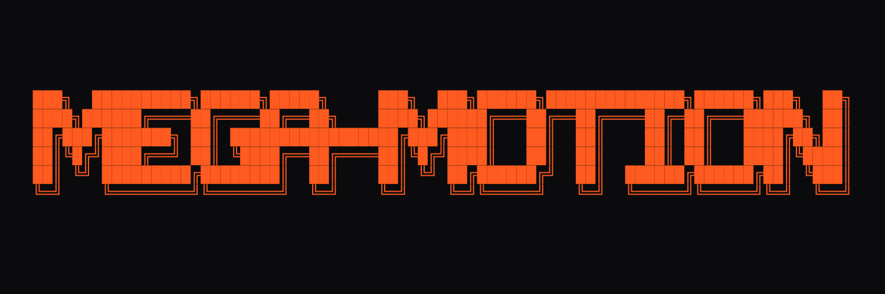

# mega-motion

<p align="center"></p>

**The one motion plugin for Claude Code.** It plans motion like a director, builds it with the right tool, and checks it like a QA team: scroll-driven websites, three.js product heroes, interface motion, and 9:16 / 1:1 / 16:9 video reels made from code.

It decides *what* should move and *why*, then hands library mechanics to the best specialist skills (official GSAP skills, HyperFrames, ffmpeg-skill) when you have them, and tells you how to get them when you don't.

## Install

In Claude Code:

```
/plugin marketplace add TroyJLorents-GH/mega-motion
/plugin install mega-motion@mega-motion
```

Then start a new session and just describe what you want ("a scroll story for my headphones", "a 15-second reel for my coffee brand"). The first time, ask it to check your setup, or run `/mega-motion:setup`.

## What's inside

| Skill | Use it for |
|---|---|
| `direct` | Start here: brief, references, beat plan, defaults, approval gates. Asks one optional question, or runs on premium house defaults |
| `setup` | Checks Node, Python, ffmpeg and its filters, Playwright, Blender and the companion skills; gives install commands; never installs without your yes |
| `study` | Measures a reference site or video clean-room (timings, easings, scroll ranges) |
| `scroll-story` | Pins, scrub, camera holds while text is read, smooth-scroll choices, iOS Safari fixes |
| `web-3d` | three.js / React Three Fiber budgets, renderer choice, phone framing, materials, delivery format |
| `blender-web` | Getting models, passes and camera paths out of Blender for the web |
| `ui-motion` | Feedback timing, hover, loading, page transitions, Flip, drag, React rules |
| `code-film` | Videos made from code. Ships a render studio (preview, stills, contact sheets, MP4 with a synthesized score, freeze and determinism checks; macOS, Windows, Linux) and a proven `launch-reel` template |
| `motion-qa` | Measurable checks before you call it done |

Agents: `motion-critic` (reviews rendered frames in a fresh context, never sees the builder's notes), `qa-runner`, `reference-analyst`.

Works with whatever model you run: no model is pinned.

## Recommended companions

mega-motion works alone, and gets better with these (the `setup` skill checks for them):

- Official GSAP skills: `/plugin marketplace add greensock/gsap-skills` then `/plugin install gsap-skills@gsap-skills`
- HyperFrames (HTML-to-video): `/plugin marketplace add heygen-com/hyperframes` then `/plugin install hyperframes@hyperframes`
- ffmpeg-skill (editing real footage, captions, platform exports): `npx ffmpeg-skill`
- Tools: Node 18+ and ffmpeg for video (the studio uses Chrome or Edge if Playwright's browser is missing); Python 3 for the score and checks; ffmpeg with libass for burned-in captions; Blender for 3D work

## Examples

Examples made from one-line prompts are coming, each with its prompt, plan, QA results and the critic's review. See [examples/](examples/) for the gallery and [examples/field-tests.md](examples/field-tests.md) to run the same tests yourself.

## Status

Early release (0.1.0). Routing and behaviour are covered by evals in `evals/` (`claude plugin eval .`); real-world quality by the field tests in `examples/`. Numbers in the skills are labelled as defaults, measurements or judgments; reported values from outside sources say so.

## Credits and licences

mega-motion's own content is MIT. The studio's capture loop follows, and its sound engine is vendored from, [elvarofficial/teardown](https://github.com/elvarofficial/teardown) and [whaleyxbt/claude-motion](https://github.com/whaleyxbt/claude-motion) (both MIT; notice in `skills/code-film/studio/core/LICENSES/`). Fonts and Playwright are installed from npm per film, not bundled. It routes to, and does not include, these projects: GSAP (GreenSock "no charge" licence, free for commercial use), three.js (MIT), HyperFrames (Apache-2.0), ffmpeg-skill by kajisho5 (MIT), Remotion (company licence above three employees). Ideas and figures cited from public articles and labs are attributed where they appear. Banner lettering made with the [useknockout](https://useknockout.com/text-to-ascii) text-to-ASCII generator (Shadow Block, Bayer 4×4 dither, Wave); it stops moving for visitors who prefer reduced motion.
